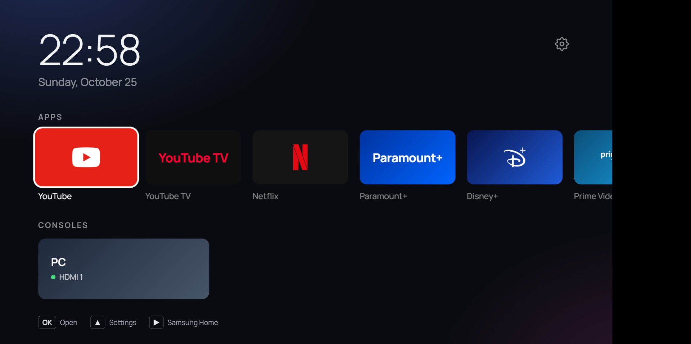
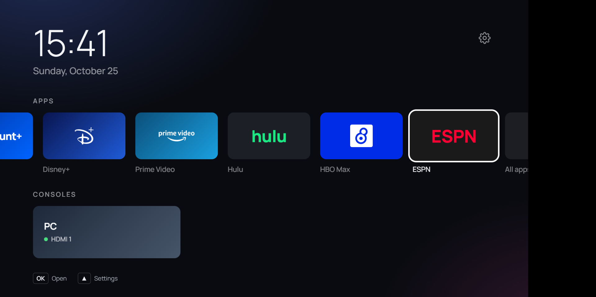

# Samsung Q80D Custom Launcher

A cleaner home screen for my 65" Samsung Q80D: a clock, one row of the streaming apps I actually use,
one row for HDMI devices, and nothing else. No ads, no "recommended" rows, no Samsung TV Plus.

It's a fork of [NelsonEU/arn0-tv](https://github.com/NelsonEU/arn0-tv), customised for this TV
(US model, Tizen 8). It's a Tizen web app (`.wgt`) installed through Developer Mode. It doesn't
root or modify the TV, and uninstalling it puts everything back the way it was.



*Browser preview of the customised Home screen. The hint bar at the bottom shows ▶ = Samsung Home.*

---

## Contents

1. [Project write-up](#project-write-up): what was done and why
2. [The TV](#the-tv)
3. [What changed from upstream](#what-changed-from-upstream)
4. [Using it with the remote](#using-it-with-the-remote)
5. [How the code is organised](#how-the-code-is-organised)
6. [Build](#build)
7. [Install or update on the TV](#install-or-update-on-the-tv)
8. [Configuration](#configuration)
9. [Maintenance and to-do](#maintenance-and-to-do)
10. [Troubleshooting](#troubleshooting)
11. [Tools not in this repo](#tools-not-in-this-repo)
12. [Repository layout](#repository-layout)
13. [Credits and licence](#credits-and-licence)

---

## Project write-up

### Goal

Samsung's own home screen on the Q80D is mostly advertising: sponsored tiles, Samsung TV Plus
channels and "recommended" content wrapped around the few apps I open. The goal was:

- **Debloat the TV** in its own settings (turn off what can be turned off).
- **Replace the home screen** with a simple launcher showing my nine streaming apps and my HDMI
  devices (a PC and a PS4).
- **Keep it reversible**: no rooting, no firmware tricks, and anything changed can be undone.

### Approach

The work was split into phases (about 4–7 hours in total):

| Phase | What | Status |
| --- | --- | --- |
| 0 | Debloat Samsung's settings | Done |
| 1 | Enable Developer Mode, build the launcher, first install | Done (2026-10-25) |
| 2 | Customise apps, brands, inputs, locale, Play-key shortcut | Done (2026-10-25) |
| 3 | Make the remote's Home button open the launcher | **Skipped on purpose** (see below) |

#### Phase 0: settings debloat

This happens in the TV's own Settings menu. No code is involved. Things worth turning off or
reviewing (menu names move around between firmware versions):

- Privacy / terms: viewing-information services, interest-based ads, voice-recognition services.
- Smart Hub autorun and Samsung TV Plus autostart.
- **Autorun Last App: ON.** The launcher relies on this: after a power cycle the TV reopens
  whatever was open last, which is usually the launcher.

#### Phase 1: Developer Mode and first install

1. Put the PC and TV on the **same network**. My house has an AT&T gateway (`192.168.1.x`) with a
   Google Nest Wifi behind it (`192.168.86.x`, double NAT). The TV is on the AT&T network, so the PC
   has to join that one as well. From the Nest side the PC can't reach the TV.
2. On the TV, enable **Developer Mode**: open *Apps*, type `1 2 3 4 5` on the remote's number pad,
   switch Developer mode **On**, enter the PC's IP address, then fully restart the TV (hold the
   power button until it reboots).
3. Check from the PC: `http://<tv-ip>:8001/api/v2/` should list `"developerMode": "1"` and the
   PC's IP as `developerIP`.
4. Build the package: `npm run build` → `dist/arn0-launcher.wgt`.
5. Sign and install it with **Apps2Samsung**, which creates a Samsung developer certificate
   for this TV. The first sign-in has to happen in a browser *on the PC* (it redirects to
   `localhost:4794`). After that the CLI installs without any sign-in:

   ```powershell
   .\tools\Apps2Samsung-cli\apps2samsung-cli.exe install arn0-tv\dist\arn0-launcher.wgt --tv 192.168.1.68
   ```

The launcher (app id `Arn0Lnchr0.Launcher`, v0.6.12) then shows up in the TV's app list.

#### Phase 2: customisation

All the changes are listed in [What changed from upstream](#what-changed-from-upstream). In short,
upstream was built for one person's European TV with a Switch, PS5 and Xbox. This fork swaps that
for my US apps, a PC and a PS4, US date format and Fahrenheit, and adds a shortcut back to
Samsung's own Home.

#### Phase 3: Home button (skipped)

Upstream ships a native helper ([`native/Control.cs`](native/Control.cs)) that rewrites Samsung's
internal settings so the remote's **Home** button opens the launcher. I deliberately did **not**
use it here:

- It is guarded to the upstream author's 2022 Q70B on Tizen 6.5 (firmware `T-PTMDEUC-1720.7`), and
  it refuses to run on anything else. This TV is a 2024 Q80D on Tizen 8 (`T-NKMAKUC-2743.0`).
- It writes undocumented platform preferences. Getting that wrong on an untested firmware could
  leave Home pointing at nothing.
- Samsung's Home is still useful: TV settings, input menus and Game Bar all hang off it.

**Decision:** the Home button stays Samsung's. The launcher is reached from the app list or
through *Autorun Last App*. To get the other way (from the launcher to Samsung Home), press
**▶ Play** on the remote. This has been confirmed working on the TV.

### Result

- The launcher installs and runs on the Q80D.
- The Home row shows YouTube, YouTube TV, Netflix, Paramount+, Disney+, Prime Video, Hulu,
  HBO Max and ESPN, each with a branded tile.
- The PC shows as an HDMI tile, and ▶ Play opens Samsung Home.
- Settings (wallpaper, fonts, clock, screen saver, Home app order, consoles) can all be changed
  from the remote and are saved on the TV.



---

## The TV

| | |
| --- | --- |
| Model | QN65Q8DTAFXZA (65" Q80D, 2024, US) |
| Firmware | T-NKMAKUC-2743.0 |
| OS | Tizen 8.0 |
| Network | AT&T gateway, `192.168.1.0/24`; TV at `192.168.1.68` (reserve it on the router so it doesn't change) |
| HDMI | PC on HDMI 1; PS4 port not confirmed yet |
| Launcher | `Arn0Lnchr0.Launcher` v0.6.12, Samsung *public* developer certificate |

---

## What changed from upstream

Two commits sit on top of upstream `b35c292`:

| File | Change |
| --- | --- |
| [`src/js/config.js`](src/js/config.js) | New Home row of nine apps, **matched by name** (no store ids are hard-coded yet). Inputs: PC on HDMI 1, PS4 placeholder. `en-US` locale, Fahrenheit. |
| [`src/js/brands.js`](src/js/brands.js) | New tile styles: YouTube TV, Paramount+, Hulu, ESPN (text wordmarks, because no SVG mark is bundled for them) and a `pc` style for the PC input. New optional `size` for wordmark font size. |
| [`src/css/style.css`](src/css/style.css) | Wordmark font size reads `--wordmark-size` (default 60px), so long names like "Paramount+" fit. |
| [`src/js/home.js`](src/js/home.js) | Applies the wordmark size. Registers the **MediaPlay / MediaPlayPause** keys and maps them to *Open Samsung Home*. Adds the ▶ hint on Home. |
| [`src/js/ui.js`](src/js/ui.js) | Key codes for Play (415), Play/Pause (10252), and `P` for the desktop preview. |
| [`src/js/settings.js`](src/js/settings.js) | Exports `openSamsungHome` for the Play key. Adds **PC** to the console logo list (Settings → Consoles → Logo). |
| [`src/js/tizen-mock.js`](src/js/tizen-mock.js) | Browser preview: fake YouTube TV, Paramount+, Hulu, HBO Max and ESPN apps; HDMI 1 and 2 connected. |
| [`scripts/build.sh`](scripts/build.sh) | Git Bash on Windows has no `zip`, so the script now falls back to Python's `zipfile` to build the `.wgt`. |
| All of `src/js/` and `native/` | Comments added throughout. |
| `README.md` | This write-up. Upstream's README is kept as [`docs/UPSTREAM-README.md`](docs/UPSTREAM-README.md). |

---

## Using it with the remote

| Key | On Home | Elsewhere |
| --- | --- | --- |
| ◀ ▶ ▲ ▼ | Move between tiles (▲ from the apps row reaches the ⚙ gear) | Move |
| OK | Open the app or switch to the input | Select |
| Back | Nothing (Home is the root) | Go back one level |
| **▶ Play / ⏯ Play-Pause** | **Open Samsung Home** (Smart Hub and TV settings) | Same |
| 🔴 Red | All apps | Back to Home (from All apps) |
| 🟢 Green | Next wallpaper | – |
| 🟡 Yellow | Hidden runner game | In All apps: show system apps too |
| 🔵 Blue | Lab (developer tests and log) | Back to Home (from Lab) |
| ◀▶◀▶◀▶ | Hidden runner game | – |

In the browser preview: arrows plus Enter, Esc or Backspace for Back, `R` `G` `Y` `B` for the colour
keys, and `P` for Play.

---

## How the code is organised

It's plain JavaScript (ES5 style, no framework and no bundler), because the TV's web engine
is old and slow. Each file is an IIFE that publishes one global (`window.Home`, `window.UI`, …).
[`src/index.html`](src/index.html) loads them in order, and [`src/js/boot.js`](src/js/boot.js)
starts them:

```
UI.init()          ui.js         key handling, focus, screens, toast, pop-up menu
Settings.init()    settings.js   every Settings screen
Screensaver.init() screensaver.js
Weather.start()    weather.js    (disabled while latitude/longitude are null)
Home.init()        home.js       Home, All apps, Lab; loads the app list; HDMI tiles
```

How data moves through it:

```
config.js  ──defaults──▶  prefs.js (localStorage on the TV)  ──▶  home.js / settings.js
                                                                    │
tizen.application.getAppsInfo() ──▶ apps.js (filter, match) ───────┤
tizen.systeminfo / tizen.tvwindow ──▶ inputs.js (HDMI) ─────────────┤
brands.js ──▶ tile colours / logos ─────────────────────────────────┘
```

| File | Role |
| --- | --- |
| `config.js` | **Edit this.** Default apps, inputs, locale, weather, sound. |
| `config.local.js` | Gitignored per-TV overrides (coordinates, dev log URL). See `config.local.example.js`. |
| `brands.js` | Tile background/foreground colour and logo for each brand. |
| `prefs.js` | Settings saved on the TV. These win over `config.js` once you change something on the TV. |
| `apps.js` | Lists installed apps, filters out Samsung's system services, matches config entries, launches. |
| `inputs.js` | Lists HDMI ports and switches source (three methods: see `inputMethod`). |
| `home.js` | Home, All apps and Lab screens; app-list cache; colour/Play key shortcuts. |
| `settings.js` | All Settings pages, the Home-apps editor, the console editor, the rename keyboard. |
| `ui.js` | View registry, remote focus grid, key dispatch, hint bar, toast, menu. |
| `wallpaper.js` / `wallpapers.js` | Background photo and rotation / generated photo list. |
| `screensaver.js` / `weather.js` | Screen saver with clock, photos and optional weather. |
| `appearance.js` | Clock format, date language, font, name visibility. |
| `sound.js` | Optional synthesised navigation click. |
| `devlog.js` | Log shown in Lab, and optionally sent to `npm run devlog` on the PC. |
| `render-probe.js` / `platform-probe.js` | Lab-only performance and API probes. |
| `runner-game.js` | Easter egg. |
| `tizen-mock.js` | Fake Tizen APIs for the browser preview. Inert on the TV. |

---

## Build

Requirements: **Node.js 20+**, plus either `zip` or Python 3 (Git Bash on Windows uses Python).

```sh
npm run preview   # browser preview at http://localhost:8080 (no TV needed)
npm run build     # → dist/arn0-launcher.wgt (unsigned; Apps2Samsung signs it on install)
npm run devlog    # receive Lab logs from the TV into logs/tv.jsonl
```

`#all`, `#lab` or `#settings` at the end of the preview URL opens that screen directly.

A prebuilt package is attached to this repo's [Releases](../../releases) page.

---

## Install or update on the TV

1. The PC must be on the same network as the TV (AT&T `192.168.1.x`, **not** the Nest Wifi).
2. Developer Mode must be on with this PC's IP (see [Phase 1](#phase-1-developer-mode-and-first-install)).
   If the PC's IP has changed, update it in the TV's Developer Mode screen and restart the TV.
3. Build, then install over the top of the existing copy:

   ```powershell
   cd "C:\Users\raine\TV Update\arn0-tv"
   npm run build
   ..\tools\Apps2Samsung-cli\apps2samsung-cli.exe install dist\arn0-launcher.wgt --tv 192.168.1.68
   ```

Updating keeps your on-TV settings (they're in localStorage). Uninstalling the app clears them.

---

## Configuration

### Apps on Home

Edit `apps` in [`src/js/config.js`](src/js/config.js). Each entry is either:

```js
{ match: 'netflix', label: 'Netflix', brand: 'netflix' }        // regex on app id or name
{ id: 'org.tizen.netflix-app', label: 'Netflix', brand: 'netflix' } // exact id (most reliable)
```

To find exact ids, press **Blue** (Lab) → *Send installed app list to log*. The order in the list is
the order on Home. You can also reorder, add and remove apps from the TV in **Settings → Apps on Home**,
and those changes are saved on the TV and take priority over `config.js`.

### HDMI inputs

```js
inputs: [
    { hdmi: 1, label: 'PC', brand: 'pc' },
    { hdmi: 2, label: 'PlayStation 4', brand: 'playstation' }
]
```

To find the right port, turn the device on, then **Blue** (Lab) → *Read inputs*. These can also be
edited on the TV in **Settings → Consoles**.

`inputMethod` controls what selecting an input does:

- `switch+viewer` (default): change source, then open Samsung's viewer, so Game Mode etc. behave
  normally.
- `switch`: change source only.
- `inapp`: show the input full screen inside the launcher, and Back returns.

### Tile look

Add or change entries in [`src/js/brands.js`](src/js/brands.js). Use `mark` for an SVG in
`src/img/marks/`, or `text` (+ optional `size`) for a typographic logo.

### Per-TV secrets / location

Copy `src/js/config.local.example.js` to `src/js/config.local.js` (gitignored) for weather
coordinates or a dev-log URL.

---

## Maintenance and to-do

- **Certificate expires 2027-10-25.** The Samsung public developer certificate (made by
  Apps2Samsung) is valid for a year. Before then, renew it in Apps2Samsung and reinstall the
  launcher, or it will stop launching.
- **Developer Mode** can be switched off by a firmware update or factory reset. If installs start
  failing, re-enable it (Phase 1, step 2).
- **To do: confirm the PS4's HDMI port** with Lab → *Read inputs*, then uncomment its line in `config.js`.
- **To do: replace `match` with exact app ids** using Lab → *Send installed app list to log*.
- **To do: test HDMI switching on the TV.** The PC tile and the dot show up in the preview, but
  switching through `tizen.tvwindow` hasn't been verified on this firmware yet. If it fails, try
  each method from the Lab screen.
- Clock defaults to 24-hour; switch to 12-hour in **Settings → Appearance** if preferred.

---

## Troubleshooting

| Symptom | Fix |
| --- | --- |
| Apps2Samsung finds 0 devices | The PC is on the Nest Wifi (`192.168.86.x`). Join the AT&T network. Check `http://192.168.1.68:8001/api/v2/` opens. |
| Install refused / "not in developer mode" | Developer Mode is off, or set to a different PC IP. Fix it and restart the TV. |
| An app is missing from Home | Its name didn't match. Check the exact name/id in Lab and update `config.js`, or add it in Settings → Apps on Home. |
| Wrong YouTube app on the YouTube tile | Pin it by `id` instead of `match`. |
| Play key does nothing | The Lab log shows "Play keys unavailable" if registration failed. Samsung Home is also reachable from Settings → Samsung Home. |
| Launcher doesn't come back after power-off | Turn on *Autorun Last App* and leave the launcher open before switching off. |
| Want to undo everything | Uninstall *Arn0 Launcher* from the TV's app list, then turn Developer Mode off. Nothing else was changed. |

---

## Tools not in this repo

The `tools/` folder next to this repo on my PC holds third-party binaries. They aren't committed,
because they're large (the GUI exe alone is 146 MB, above GitHub's 100 MB file limit), they
belong to someone else, and they bundle signing certificates and passwords that shouldn't be
republished.

| Tool | Version | Used for | Get it |
| --- | --- | --- | --- |
| Apps2Samsung (GUI) | 2.8.3 win-x64 | Creating the Samsung developer certificate; first install | [Apps2Samsung releases](https://github.com/Apps2Samsung/Apps2Samsung/releases) |
| apps2samsung-cli | 3.0.0-beta win-x64 | Command-line installs/updates | Same project |

Your own Samsung certificate lives in Apps2Samsung's user data, not in this repo. `.gitignore`
blocks `*.p12`, `*.pem`, `*.cer` and similar, so it can't be committed by accident.

---

## Repository layout

```
├── README.md                 this write-up
├── LICENSE                   MIT (upstream)
├── package.json              npm scripts: preview, build, devlog, icon, fetch-assets
├── docs/
│   ├── UPSTREAM-README.md    original arn0-tv README (full feature reference)
│   ├── setup-tv.md           upstream TV setup + Home-button guide (Phase 3, not used here)
│   ├── preview.png           upstream screenshot
│   └── screenshots/          previews of this customised version
├── native/                   upstream Home-button helpers (C#, guarded to the Q70B; unused)
├── scripts/                  build, preview server, devlog server, asset/wallpaper tools
└── src/                      everything that goes into the .wgt
    ├── config.xml            Tizen manifest: app id, privileges, version
    ├── index.html            all screens' markup
    ├── css/style.css
    ├── fonts/                Manrope, Inter, Outfit, DM Sans (OFL)
    ├── img/                  brand marks, pre-coloured tiles, wallpapers
    └── js/                   the launcher (see "How the code is organised")
```

---

## Credits and licence

- Launcher by **Arnaud Etienne**: [NelsonEU/arn0-tv](https://github.com/NelsonEU/arn0-tv), MIT licence
  (see [LICENSE](LICENSE)). This fork keeps the full upstream history.
- Fonts under the SIL Open Font Licence; wallpapers under the Unsplash Licence; weather from
  [Open-Meteo](https://open-meteo.com/). Brand names and logos belong to their owners.
- Installed with [Apps2Samsung](https://github.com/Apps2Samsung/Apps2Samsung).
- Not affiliated with Samsung or any streaming service. Use at your own risk.
